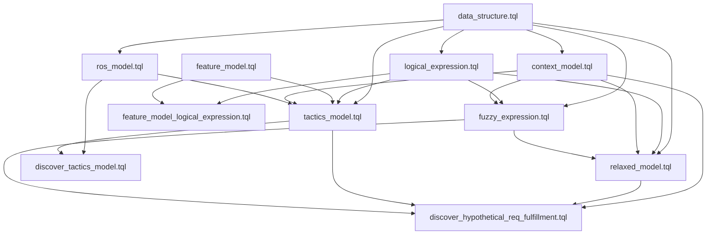

# typedb_tactics

`typedb_tactics` is a ROS 2 package for representing adaptation knowledge in TypeDB and using that knowledge to support runtime decision-making for self-adaptive systems. It combines TypeDB schemas, Python query interfaces, ROS 2 integration, tests, and helper scripts in one package.

In practice, this package defines the domain models used by the managing system, loads them into TypeDB, and exposes the resulting capabilities through ROS-facing interfaces.

## Navigation

- [Repository Structure](#repository-structure)
- [Scripts](#scripts)
- [Models](#models)
- [Quick Start](#quick-start)
- [Docker](#docker)

## Repository Structure

This package is organized around TypeDB schemas, Python interfaces that wrap the database logic, ROS 2 integration, tests, and helper scripts.

```text
typedb_tactics/
├── launch/                  # ROS 2 launch files
├── schemas/                 # TypeDB schema definitions, examples, and queries
├── schemas_diagrams/        # Generated schema figures
├── scripts/                 # Helper scripts for diagrams, benchmarks, profiling, and test execution
├── test/                    # Python test suite and test data
├── typedb_tactics/          # Main Python package
│   ├── tactical_retreat_kb.py
│   ├── tactical_retreat_node.py
│   └── typedb_tactical_retreat_interface.py
├── package.xml
├── setup.py
└── README.md
```

## Scripts

This repository includes helper scripts for:

- generating schema diagrams
- generating a merged schema diagram
- benchmarking query and interface performance
- profiling schema load times
- running tests inside Docker

Check the dedicated scripts guide:

- [`scripts/README.md`](./scripts/README.md)

## Models

Schema files are organized under `schemas/` by model:

```text
schemas/
├── context_model/
├── data_structure/
├── discover_hypothetical_req_fulfillment/
├── discover_tactics_model/
├── feature_model/
├── logical_expressions/
├── relaxed/
├── ros_model/
├── states/
└── tactics_model/
```

This section briefly describes the main models included in the repository and where to find them.

- `data_structure/`: core typed values and array/value abstractions used by the rest of the schemas
- `context_model/`: measurements, measurement sources, and runtime context information
- `ros_model/`: runtime ROS graph entities such as nodes, topics, services, actions, QoS, and parameters
- `feature_model/`: feature-model structures, feature hierarchies, and cross-tree constraints
- `logical_expressions/`: logical and fuzzy expression models used to represent conditions and evaluations
- `relaxed/`: RELAX requirement models and requirement fulfillment concepts
- `tactics_model/`: adaptation tactics, their metadata, and tactic-rule structures
- `discover_tactics_model/`: discovery queries/model fragments for identifying applicable tactics
- `discover_hypothetical_req_fulfillment/`: discovery queries/model fragments for hypothetical requirement fulfillment
- `states/`: state-related schema definitions used by the managing system

### Dependencies



Arrows point from each prerequisite model to the model that depends on it.

## Quick Start

For local development:

```Bash
source /opt/ros/humble/setup.bash
source install/setup.bash
```

Make sure a TypeDB server is running on `localhost:1729`, then launch the KB node:

```Bash
ros2 launch typedb_tactics tactical_retreat_kb.launch.py \
  schema_path:="['schemas/data_structure/data_structure.tql','schemas/context_model/context_model.tql','schemas/ros_model/ros_model.tql']" \
  data_path:="['test/data/test_ros_model.tql']" \
  database_name:=tactical_kb \
  address:=localhost:1729 \
  force_database:=True \
  force_data:=True \
  infer:=True
```

Adjust `schema_path` and `data_path` for your use case. They can be absolute paths or paths relative to the package root.

## Docker

### Pull

You can get the latest docker image with:

```Bash
docker pull ghcr.io/kas-lab/typedb_tactics:latest
```

### Build

To build the img you need to create a github personal access token to read access to private repos, then log in to gh with gh cli

```Bash
gh auth login         # if not logged in
```

Build:

```Bash
docker build --secret id=gh_token,src=<(gh auth token) --build-arg DEPS_CACHE_BUSTER=${date} -t tactical_retreat .
```

### Run

```Bash
xhost +
```

The commands below assume you are running them from the workspace root, so `"$PWD/src/..."` points to the local packages:

```Bash
cd <workspace_root>
```

Choose the smallest command that matches your use case:
- plain container if you only need `typedb_tactics`
- NVIDIA variant if you need GPU support
- extra mounts if you are editing `ros_monitors` or `ros_typedb` together with this package

Start container in the background with typedb server running:

```Bash
docker run -d --rm --name tactical_retreat -e DISPLAY=$DISPLAY -e QT_X11_NO_MITSHM=1 -v /tmp/.X11-unix:/tmp/.X11-unix -v /etc/localtime:/etc/localtime:ro -v "$PWD/src/typedb_tactics:/home/ubuntu-user/tactical_retreat_ws/src/typedb_tactics" tactical_retreat typedb server
```

With nvidia

```Bash
docker run -d --rm --name tactical_retreat --runtime=nvidia --gpus all -e DISPLAY=$DISPLAY -e QT_X11_NO_MITSHM=1 -v /tmp/.X11-unix:/tmp/.X11-unix -v /etc/localtime:/etc/localtime:ro -v "$PWD/src/typedb_tactics:/home/ubuntu-user/tactical_retreat_ws/src/typedb_tactics" tactical_retreat typedb server
```

Mount ros_typedb as well:

```Bash
docker run -d --rm --name tactical_retreat --runtime=nvidia --gpus all -e DISPLAY=$DISPLAY -e QT_X11_NO_MITSHM=1 -v /tmp/.X11-unix:/tmp/.X11-unix -v /etc/localtime:/etc/localtime:ro -v "$PWD/src/typedb_tactics:/home/ubuntu-user/tactical_retreat_ws/src/typedb_tactics" -v "$PWD/src/ros_monitors:/home/ubuntu-user/tactical_retreat_ws/src/ros_monitors" -v "$PWD/src/ros_typedb:/home/ubuntu-user/tactical_retreat_ws/src/ros_typedb" tactical_retreat typedb server
```

Mount ros_monitors as well:

```Bash
docker run -d --rm --name tactical_retreat --runtime=nvidia --gpus all -e DISPLAY=$DISPLAY -e QT_X11_NO_MITSHM=1 -v /tmp/.X11-unix:/tmp/.X11-unix -v /etc/localtime:/etc/localtime:ro -v "$PWD/src/typedb_tactics:/home/ubuntu-user/tactical_retreat_ws/src/typedb_tactics" -v "$PWD/src/ros_monitors:/home/ubuntu-user/tactical_retreat_ws/src/ros_monitors" tactical_retreat typedb server
```

**Note:** Use the correct image name, if you got the img from the github registry use `ghcr.io/kas-lab/typedb_tactics:latest` instead of `tactical_retreat`

Start new terminal in the container:

```Bash
docker exec -it tactical_retreat bash
```

### Test

```Bash
colcon test --event-handlers console_cohesion+ --packages-select typedb_tactics
```
