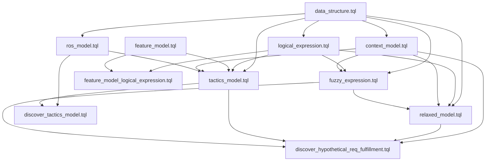

# typedb_tactics

## Models

### Dependencies



Arrows point from each prerequisite model to the model that depends on it.

## Docker

### Pull

You can get the latest docker image with:

```Bash
docker pull ghcr.io/kas-lab/typedb_tactics:latest
```

### Build

To build the img you need to create a github personal access token to read access to private repos, then log in to gh with gh cli

```Bash
gh auth login         # if not logged in
```

Build:

```Bash
docker build --secret id=gh_token,src=<(gh auth token) --build-arg DEPS_CACHE_BUSTER=${date} -t tactical_retreat:typedb3 .
```

### Run

```Bash
xhost +
```

Start container in the background with typedb server running:

```Bash
docker run -d --rm --name tactical_retreat -e DISPLAY=$DISPLAY -e QT_X11_NO_MITSHM=1 -v /tmp/.X11-unix:/tmp/.X11-unix -v /etc/localtime:/etc/localtime:ro -v $HOME/tactical_retreat_ws/src/typedb_tactics:/home/ubuntu-user/tactical_retreat_ws/src/typedb_tactics tactical_retreat typedb server
```

```Bash
docker run -d --rm --name tactical_retreat -e DISPLAY=$DISPLAY -e QT_X11_NO_MITSHM=1 -v /tmp/.X11-unix:/tmp/.X11-unix -v /etc/localtime:/etc/localtime:ro -v $HOME/ros_workspaces/tactical_retreat_ws/src/typedb_tactics:/home/ubuntu-user/tactical_retreat_ws/src/typedb_tactics tactical_retreat typedb server
```

With nvidia

```Bash
docker run -d --rm --name tactical_retreat --runtime=nvidia --gpus all -e DISPLAY=$DISPLAY -e QT_X11_NO_MITSHM=1 -v /tmp/.X11-unix:/tmp/.X11-unix -v /etc/localtime:/etc/localtime:ro -v $HOME/ros_workspaces/tactical_retreat_ws/src/typedb_tactics:/home/ubuntu-user/tactical_retreat_ws/src/typedb_tactics tactical_retreat typedb server
```

Mount ros_typedb as well:

```Bash
docker run -d --rm --name tactical_retreat --runtime=nvidia --gpus all -e DISPLAY=$DISPLAY -e QT_X11_NO_MITSHM=1 -v /tmp/.X11-unix:/tmp/.X11-unix -v /etc/localtime:/etc/localtime:ro -v $HOME/ros_workspaces/tactical_retreat_ws/src/typedb_tactics:/home/ubuntu-user/tactical_retreat_ws/src/typedb_tactics -v $HOME/ros_workspaces/tactical_retreat_ws/src/ros_typedb:/home/ubuntu-user/tactical_retreat_ws/src/ros_typedb tactical_retreat:typedb3 sudo typedb server
```

From the `tactical_retreat_ws` folder:

```Bash
docker run -d --rm --name tactical_retreat --runtime=nvidia --gpus all -e DISPLAY=$DISPLAY -e QT_X11_NO_MITSHM=1 -v /tmp/.X11-unix:/tmp/.X11-unix -v /etc/localtime:/etc/localtime:ro -v ${PWD}/src/typedb_tactics:/home/ubuntu-user/tactical_retreat_ws/src/typedb_tactics -v $HOME/ros_workspaces/tactical_retreat_ws/src/ros_monitors:/home/ubuntu-user/tactical_retreat_ws/src/ros_monitors -v ${PWD}/src/ros_typedb:/home/ubuntu-user/tactical_retreat_ws/src/ros_typedb tactical_retreat:typedb3 sudo typedb server
```

Mount ros_monitors as well:

```Bash
docker run -d --rm --name tactical_retreat --runtime=nvidia --gpus all -e DISPLAY=$DISPLAY -e QT_X11_NO_MITSHM=1 -v /tmp/.X11-unix:/tmp/.X11-unix -v /etc/localtime:/etc/localtime:ro -v $HOME/ros_workspaces/tactical_retreat_ws/src/typedb_tactics:/home/ubuntu-user/tactical_retreat_ws/src/typedb_tactics -v $HOME/ros_workspaces/tactical_retreat_ws/src/ros_monitors:/home/ubuntu-user/tactical_retreat_ws/src/ros_monitors tactical_retreat typedb server
```

**Note:** Use the correct image name, if you got the img from the github registry use `ghcr.io/kas-lab/typedb_tactics:latest` instead of `tactical_retreat`

Start new terminal in the container:

```Bash
docker exec -it tactical_retreat bash
```

### Test

```Bash
colcon test --event-handlers console_cohesion+ --packages-select typedb_tactics
```

### Benchmark Query + Initialization Bottlenecks

Run from the container in the `scripts` folder:

```Bash
cd /home/ubuntu-user/tactical_retreat_ws/src/typedb_tactics/scripts
python3 benchmark_queries.py
```

Useful options:

```Bash
# Only hypothetical-fulfillment fixture profile
python3 benchmark_queries.py --profiles hyp --runs 10

# Only generated dataset
python3 benchmark_queries.py --profiles generated --runs 10

# JSON output for before/after diffing
python3 benchmark_queries.py --profiles generated,hyp --runs 10 --format json
```

Output includes:
- initialization breakdown (`init_no_schema`, per-schema timings, per-data-file timings)
- query latency stats (`cold`, `warm_avg`, `warm_p50`, `warm_p95`)
- row count stability across warm runs
- top 3 slowest query cases (by warm p50)
- top 3 slowest schema files (by load time)

Interpretation notes:
- `cold` includes first-call overhead; use `warm_p50`/`warm_p95` for steady-state latency.
- Run with `--no-infer` only for comparison studies; production behavior should be benchmarked with inference enabled.

### Benchmark Interface Methods (`benchmark.py`)

Run from the container in the `scripts` folder:

```Bash
cd /home/ubuntu-user/tactical_retreat_ws/src/typedb_tactics/scripts
python3 benchmark.py
```

Useful options:

```Bash
# Run each benchmark case multiple times
python3 benchmark.py --runs 10

# Benchmark only specific get_* methods
python3 benchmark.py --runs 10 --methods get_potential_requirements_fulfillment,get_applicable_tactics

# Limit number of argument combinations per method
python3 benchmark.py --runs 10 --methods get_potential_requirements_fulfillment --max-combinations 50
```

What this benchmark measures:
- `TacticalRetreatInterface` creation time (schema + data load)
- `get_expression_satisfied` latency for the fixed expression list in the script
- all `get_*` methods in `TacticalRetreatInterface` (or the subset passed with `--methods`)

Output includes:
- per-case latency stats (`avg`, `p50`, `p95`)
- success/failure counts per method call combination
- result size summary (`avg`, `min`, `max`)
- methods sorted by decreasing average latency
- skipped methods (missing input context) and methods with only failed invocations

Interpretation notes:
- Use `--methods` to isolate hotspots and reduce runtime when iterating.
- `--max-combinations` is useful for quick A/B checks on query or rule changes.
- For full-impact checks, run without `--methods` and without `--max-combinations`.
