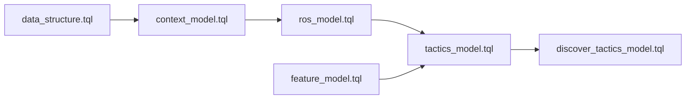

# typedb_tactics

## Models

### Dependencies



Arrows point from each prerequisite model to the model that depends on it.

## Docker

### Pull

You can get the latest docker image with:

```Bash
docker pull ghcr.io/kas-lab/typedb_tactics:latest
```

### Build

To build the img you need to create a github personal access token to read access to private repos, then log in to gh with gh cli

```Bash
gh auth login         # if not logged in
```

Build:

```Bash
docker build --secret id=gh_token,src=<(gh auth token) --build-arg DEPS_CACHE_BUSTER=${date} -t rebet .
```

### Run

```Bash
xhost +
```

Start container in the background with typedb server running:

```Bash
docker run -d --rm --name rebet -e DISPLAY=$DISPLAY -e QT_X11_NO_MITSHM=1 -v /tmp/.X11-unix:/tmp/.X11-unix -v /etc/localtime:/etc/localtime:ro -v $HOME/rebet_ws/src/typedb_tactics:/home/ubuntu-user/rebet_ws/src/typedb_tactics rebet typedb server
```

```Bash
docker run -d --rm --name rebet -e DISPLAY=$DISPLAY -e QT_X11_NO_MITSHM=1 -v /tmp/.X11-unix:/tmp/.X11-unix -v /etc/localtime:/etc/localtime:ro -v $HOME/ros_workspaces/rebet_ws/src/typedb_tactics:/home/ubuntu-user/rebet_ws/src/typedb_tactics rebet typedb server
```

```Bash
docker run -d --rm --name rebet --runtime=nvidia --gpus all -e DISPLAY=$DISPLAY -e QT_X11_NO_MITSHM=1 -v /tmp/.X11-unix:/tmp/.X11-unix -v /etc/localtime:/etc/localtime:ro -v $HOME/ros_workspaces/rebet_ws/src/typedb_tactics:/home/ubuntu-user/rebet_ws/src/typedb_tactics rebet typedb server
```

```Bash
docker run -d --rm --name rebet --runtime=nvidia --gpus all -e DISPLAY=$DISPLAY -e QT_X11_NO_MITSHM=1 -v /tmp/.X11-unix:/tmp/.X11-unix -v /etc/localtime:/etc/localtime:ro -v $HOME/ros_workspaces/rebet_ws/src/typedb_tactics:/home/ubuntu-user/rebet_ws/src/typedb_tactics -v $HOME/ros_workspaces/rebet_ws/src/ros_monitors:/home/ubuntu-user/rebet_ws/src/ros_monitors rebet typedb server
```

**Note:** Use the correct image name, if you got the img from the github registry use `ghcr.io/kas-lab/typedb_tactics:latest` instead of `rebet`

Start new terminal in the container:

```Bash
docker exec -it rebet bash
```

### Test

```Bash
colcon test --event-handlers console_cohesion+ --packages-select typedb_tactics
```
