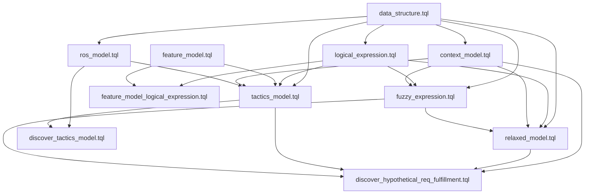

# typedb_tactics

ROS 2 package that exposes a TypeDB-backed knowledge base for runtime adaptation tactics.

## Models

### Schema dependencies



Arrows point from prerequisite model to dependent model.

### What each schema is for

- `data_structure`: foundational shared structures used across models.
- `context_model`: runtime/environment context (measurements, interfaces).
- `ros_model`: ROS graph/domain entities and relations.
- `logical_expressions`: base logical expression vocabulary and composition.
- `fuzzy_expression`: fuzzy extensions over logical/context concepts.
- `feature_model`: feature definitions; `feature_model_logical_expression` bridges features with logical expressions.
- `relaxed_model`: relaxed/graded requirement fulfillment semantics.
- `tactics_model`: adaptation tactics representation and resolution queries.
- `discover_tactics_model`: tactic discovery and neighborhood reasoning.
- `discover_hypothetical_req_fulfillment`: hypothetical requirement-fulfillment analysis.

For agent-focused schema notes and query-writing pointers, see `agent-docs/schema-guide.md`.

## Prerequisites

- Docker
- ROS 2 Humble (inside container image)
- TypeDB 3.x (inside container image)
- `gh` CLI auth if you need to build the image from source with private deps

## Docker workflow

### Pull image

```bash
docker pull ghcr.io/kas-lab/typedb_tactics:latest
```

### Build image (optional)

```bash
gh auth login
docker build --secret id=gh_token,src=<(gh auth token) \
  --build-arg DEPS_CACHE_BUSTER=$(date +%s) \
  -t tactical_retreat:typedb3 .
```

### Run container

Start in background with TypeDB server running:

```bash
docker run -d --rm --name tactical_retreat \
  -v /etc/localtime:/etc/localtime:ro \
  -v $HOME/ros_workspaces/tactical_retreat_3_ws/src/typedb_tactics:/home/ubuntu-user/tactical_retreat_ws/src/typedb_tactics \
  -v $HOME/ros_workspaces/tactical_retreat_3_ws/src/ros_monitors:/home/ubuntu-user/tactical_retreat_ws/src/ros_monitors \
  tactical_retreat:typedb3 typedb server
```

If using the registry image, replace `tactical_retreat:typedb3` with `ghcr.io/kas-lab/typedb_tactics:latest`.

If you are also editing `ros_typedb`, include an extra mount:

```bash
-v $HOME/ros_workspaces/tactical_retreat_3_ws/src/ros_typedb:/home/ubuntu-user/tactical_retreat_ws/src/ros_typedb
```

### Open shell

```bash
docker exec -it tactical_retreat bash
```

## Build and test

All commands below run from `src/typedb_tactics`.

### Build package

```bash
docker exec tactical_retreat bash -lc \
  "source /opt/ros/humble/setup.bash && \
   cd /home/ubuntu-user/tactical_retreat_ws && \
   colcon build --symlink-install --packages-select typedb_tactics"
```

### Run tests

Run tests:

```Bash
colcon test --event-handlers console_cohesion+ --packages-select typedb_tactics
```

Full package tests:

```bash
scripts/run-tests-docker.sh
```

Focused tests:

```bash
scripts/run-tests-docker.sh -k test_ros_model
scripts/run-tests-docker.sh -k test_hyp
```

Mandatory style checks:

```bash
docker exec tactical_retreat bash -lc \
  "source /opt/ros/humble/setup.bash && \
   source /home/ubuntu-user/tactical_retreat_ws/install/setup.bash && \
   colcon test --event-handlers console_cohesion+ --packages-select typedb_tactics --pytest-args -k test_flake8"

docker exec tactical_retreat bash -lc \
  "source /opt/ros/humble/setup.bash && \
   source /home/ubuntu-user/tactical_retreat_ws/install/setup.bash && \
   colcon test --event-handlers console_cohesion+ --packages-select typedb_tactics --pytest-args -k test_pep257"
```

## Run the KB node

```bash
ros2 launch typedb_tactics tactical_retreat_kb.launch.py \
  schema_path:="['schemas/data_structure/data_structure.tql','schemas/context_model/context_model.tql','schemas/ros_model/ros_model.tql']" \
  data_path:="['test/data/test_ros_model.tql']" \
  database_name:=tactical_kb \
  address:=localhost:1729 \
  force_database:=True \
  force_data:=True
```

## Benchmarking

Run from container:

```bash
docker exec tactical_retreat bash -lc \
  "source /opt/ros/humble/setup.bash && \
   source /home/ubuntu-user/tactical_retreat_ws/install/setup.bash && \
   cd /home/ubuntu-user/tactical_retreat_ws/src/typedb_tactics/scripts && \
   python3 benchmark_queries.py --profiles hyp --runs 5"

docker exec tactical_retreat bash -lc \
  "source /opt/ros/humble/setup.bash && \
   source /home/ubuntu-user/tactical_retreat_ws/install/setup.bash && \
   cd /home/ubuntu-user/tactical_retreat_ws/src/typedb_tactics/scripts && \
   python3 benchmark.py --runs 5 --methods get_potential_requirements_fulfillment"
```

## Notes

- TypeDB result order is not guaranteed; sort in Python when test assertions require deterministic ordering.
- `infer` is not part of current `typedb_tactics` launch/interface parameters.
